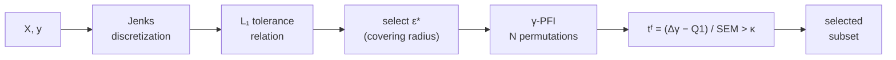
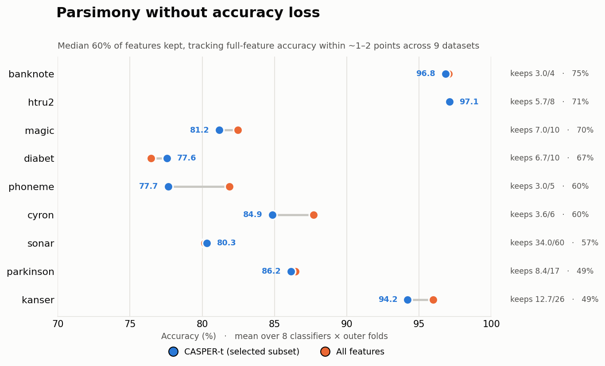

# CASPER-t

[](https://pypi.org/project/casper-fs/)
[](https://pypi.org/project/casper-fs/)
[](LICENSE)
[](https://scikit-learn.org)

**C**overing **A**pproximation **S**pace **P**ermutation **E**limination **R**ule
(with a Monte Carlo reliability margin *t*) a **topological feature selector**,
packaged as a drop-in scikit-learn transformer.

> Keep a *small, confident* subset of features instead of all of them without
> paying for it in accuracy. On 9 benchmark datasets CASPER-t retains a **median
> 60 % of features** while tracking full-feature accuracy to within **~1–2 points**.

```bash
pip install casper-fs
```

---

## How it works

CASPER-t treats each feature's usefulness as a *measured quantity with an error
bar*, and keeps a feature only when its measured contribution clears a reliability
margin not merely when it looks large once.



1. **Discretize** each feature by unsupervised **Jenks natural breaks**.
2. Build an **L₁ tolerance relation** and pick the covering radius **ε\*** that
   maximises the γ dependency degree (just below saturation).
3. Score every feature by the **drop in γ under *N* permutations** (γ-PFI). A
   permutation-importance signal native to the covering approximation space.
4. Retain a feature only when that drop clears the first quartile of the
   feature-wise distribution **by a reliable margin**:

   > **tᶠ = (mean(Δγ\_f) − Q1) / SEM\_f > κ**   (default κ = 1.5)

Everything is refit on the training split it is given, so it is **leakage-free**
inside a scikit-learn `Pipeline` / cross-validation loop.

---

## Benchmark

**Protocol.** Training-fold-confined repeated cross-validation (5 folds × 2 repeats) on **9 datasets**, evaluated across **8
classifiers**, against **13 feature-selection baselines** (filter, wrapper,
embedded, and rough-set families). Baselines are compared at **matched cardinality**. Each is truncated to CASPER-t's own per-fold feature count. So, every method is judged on the *same feature budget*.



The headline is **parsimony**. CASPER-t discards 25–51 % of the features yet stays
within a point or two of using everything and **matches or beats the full set on
4 of 9 datasets** (banknote, diabet, htru2, sonar).

| Dataset | Features kept (K / p) | CASPER-t acc. | All-features acc. | Δ |
|---|---|---|---|---|
| banknote  | 3.0 / 4   | 96.8 | 97.1 | −0.2 |
| htru2     | 5.7 / 8   | 97.1 | 97.0 | **+0.1** |
| magic     | 7.0 / 10  | 81.2 | 82.5 | −1.3 |
| diabet    | 6.7 / 10  | 77.6 | 76.5 | **+1.1** |
| phoneme   | 3.0 / 5   | 77.7 | 81.9 | −4.2 |
| cyron     | 3.6 / 6   | 84.9 | 87.7 | −2.9 |
| sonar     | 34.0 / 60 | 80.3 | 80.2 | **+0.2** |
| parkinson | 8.4 / 17  | 86.2 | 86.4 | −0.3 |
| kanser    | 12.7 / 26 | 94.2 | 96.0 | −1.8 |

*Accuracy is the mean over 8 classifiers × outer folds. K is the mean per-fold
subset size, p is the number of candidate features.*

**On honest terms.** At a matched feature budget no single selector dominates the
field. CASPER-t's mean **Accuracy rank is mid-pack (≈ 7.7 of 14 methods)**, and
its value is the *combination* of a principled topological criterion with a
reliability gate that yields compact subsets. Every rank, dispersion (fold std and
across-classifier std), and per-fold number behind these figures is shipped in
[`detailed_tables/`](detailed_tables/), nothing is averaged away.

---

## Quickstart

```python
from casper import CasperT
from sklearn.pipeline import Pipeline
from sklearn.svm import SVC
from sklearn.model_selection import cross_val_score
from sklearn.datasets import load_breast_cancer

X, y = load_breast_cancer(return_X_y=True)

# standalone
sel = CasperT(kappa=1.5, n_permutations=30, random_state=42).fit(X, y)
print(sel.get_support().sum(), "features selected")     # -> 13 of 30
print(sel.eps_star_, sel.t_stats_)                      # diagnostics

# leakage-free inside a Pipeline (refits per fold)
pipe = Pipeline([("casper", CasperT()), ("clf", SVC())])
cross_val_score(pipe, X, y, cv=5)
```

Requires Python ≥ 3.9, `numpy`, `scipy`, `scikit-learn`. Install from a clone with
`pip install .`. For the compiled kernel add the optional extra, `pip install "casper-fs[fast]"`
(installs `numba`).

### Speed

The dependency degree is evaluated by an exact fast engine (`casper/_fast.py`). It
gives the same ε\*, the same γ, the same Δγ and SEM for every replicate, and therefore
the same subset, as the direct implementation in `casper/_core.py`. The equality is bit for bit, and `tests/test_fast_equivalence.py`
checks it. Three facts remove work that cannot change the result:

1. Objects with the same code vector share their tolerance class, minimal
   neighbourhood and lower-approximation status. γ is computed on the distinct patterns,
   weighted by their counts. A pattern that holds two classes is never in the lower
   approximation.
2. The tolerance relation is reflexive and symmetric, so T(x) ⊆ T(z) forces z ∈ T(x).
   Only neighbours of another class need the inclusion test. With `numba`, packed bit
   rows run that test and stop at the first witness.
3. γ is a count divided by n, so it does not depend on the order of the objects.

Measured on the first outer fold, one γ-PFI fit (ε scan plus 30 permutations per
feature), 8 threads:

| Dataset | m | p | distinct rows | direct (s) | fast (s) |
|---|---|---|---|---|---|
| HTRU2 | 3000 | 8 | 137 | 14.3 | 0.17 |
| Phoneme | 3000 | 5 | 155 | 8.9 | 0.13 |
| MAGIC | 3000 | 10 | 1014 | 18.0 | 1.9 |
| Banknote | 1097 | 4 | 43 | 0.60 | 0.02 |
| Breast Cancer | 455 | 30 | 451 | 0.56 | 0.11 |

Under the measurement protocol of the article (one fit per fold, folds in parallel, three
threads each) a full fit on the nine main datasets takes 0.01–3.4 s. That is faster than
Boruta, RFE, ReliefF, standard permutation importance, GBNRS and GBRS on every dataset,
and slower only than plain filter scores (ANOVA, mutual information, LASSO, HSIC-Lasso)
and QuickReduct.

Without `numba` the NumPy fallback is used. It is also exact, only slower.

## API

`CasperT(kappa=1.5, n_permutations=30, max_bins=7, target_gvf=0.80, max_topological=3000, random_state=42)`

| Parameter | Meaning |
|---|---|
| `kappa` | reliability margin of the tᶠ rule; larger ⇒ fewer, more confident features |
| `n_permutations` | permutation replicates per feature in γ-PFI |
| `max_bins` / `target_gvf` | Jenks bin cap / goodness-of-variance-fit early-stop target |
| `max_topological` | subsample cap for the topological stage (evaluation uses full data) |

Fitted attributes: `support_`, `delta_gamma_`, `sem_`, `t_stats_`, `eps_star_`,
`gamma_base_`, `q1_`. Standard `SelectorMixin` API: `fit`, `transform`,
`get_support`, `get_feature_names_out`.

## Reproducing the article

`pipeline/gamma_pfi_uhem.py` is the full cross-validation pipeline used for the paper
(all baselines, statistics, and per-fold outputs); `pipeline/make_tables.py`
regenerates the LaTeX tables from those outputs.
`code/` holds the experiment core (`CasperSelector`, the exact fast evaluation) and the
tests cited in the article's appendix, see `code/README.md`.

### Detailed results (`detailed_tables/`)

The article's tables report means only, for readability. These files hold the same
numbers **with their dispersion and at fold-level granularity**:

| File | What it is |
|---|---|
| `summary_mean_std.csv` | one row per (dataset × method × metric): mean, fold std, across-classifier std, retained `K`, `p`, retained % |
| `fold_level_hybrid.csv` | every outer fold, HYBRID classifier only |
| `fold_level_raw.csv.gz` | every outer fold × 8 classifiers × every method |

Method ids: `V1_tstat` = CASPER-t; `*_matchK` = baselines truncated at CASPER-t's
per-fold cardinality; `*_native` = rough-set baselines at their own stopping point;
`ALL` = full feature set.

## Citation

If you use CASPER-t, please cite the article:

```bibtex
@article{casper_t,
  title  = {A Topological Feature Selection Framework via Generalized Covering
            Approximation Spaces with Permutation Importance},
  author  = {Yiğit, Uğur and Boyabatlı, Kenan Evren and Çuhadar, Ebrar and
             Elgün, Esma Nur and Sönmez, Ertan},
  journal = {Preprint},
  year    = {2026}
}
```

## License

MIT — see [LICENSE](LICENSE).
